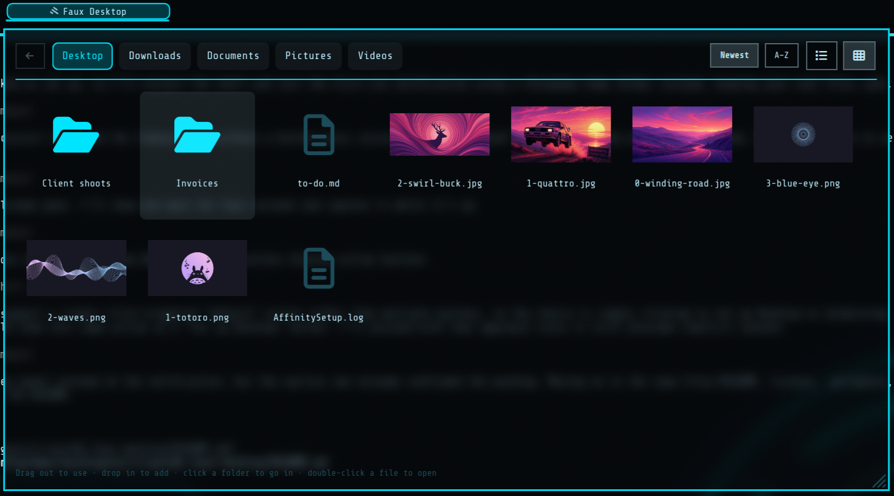

# Faux Desktop

Miss having files on your desktop? Faux Desktop puts a folder on the Omarchy bar.
Hover over it and the folder opens as a panel. Drag files out into any app, drop
files in, and open folders inside it, spring-loaded like on macOS.



## Features

- **Hover to open.** A box on the bar opens the panel as soon as the pointer
  touches it, including when you throw the pointer to the top edge of the screen.
  It closes a quarter of a second after the pointer leaves.
- **Drag out.** Drag any file or folder from the panel into a browser upload
  box, an email, a chat or an editor.
- **Drop in.** Drop files on the bar box or into the panel to copy them into the
  folder. Nothing is ever overwritten.
- **Spring-loaded folders.** Hold dragged files over the bar box and the panel
  opens. Hold them over a folder and it opens. Hold them over ← and you go up a
  level. Each wait is 0.4 seconds, shown by a sweep across the target.
- **Pinned folders.** The top of the panel has buttons for your home folder,
  Downloads, Documents, Pictures and Videos. Rest on one for a quarter of a
  second, or click it, to switch. The panel always reopens on the home folder.
- **Folders.** Click a folder to open it. ← goes up a level, and a path shows
  where you are.
- **List or icons.** Switch between a list and a grid of thumbnails.
- **Sort.** Sort by newest or by name.
- **Resizable.** Drag the bottom-right corner to resize the panel. The size is
  remembered.
- **Themed.** The panel uses the active theme's menu style, so it fits stock
  themes and glass themes alike (see [Glass themes](#glass-themes)).

## Install

```bash
omarchy plugin add https://github.com/crispin81/omarchy-faux-desktop --enable
```

The first time it loads, Faux Desktop shows one notification:

> **Faux Desktop: set up a Desktop folder?**
> Click here to create ~/Desktop and pin it to the top of the file manager
> sidebar. Dismiss to use Downloads instead.

Nothing changes on your system unless you click that notification. If you
dismiss or ignore it, Faux Desktop opens on Downloads. Your answer is stored in
`~/.local/state/faux-desktop/setup`. Delete that file to be asked again on the
next shell start.

It's placed in the left section of the bar. To move it, for example after the
workspaces:

```bash
omarchy bar move crispin81.faux-desktop --after omarchy.workspaces
```

## Settings

Omarchy doesn't have a settings screen for bar widgets, so settings are changed
with `omarchy bar set`:

| Setting | Values | Default |
|---|---|---|
| `folder` | Any folder, e.g. `~/Desktop` | empty: Desktop if set up on first run, otherwise Downloads |
| `openOnHover` | `true` / `false` | `true` |
| `hoverDelay` | milliseconds before hover opens the panel | `0` |
| `dropAction` | `copied` / `moved` | `copied` |
| `sortBy` | `newest` / `name` | `newest` |
| `viewMode` | `list` / `icons` | `list` |
| `slotWidth` | minimum width of the bar box in px (0 = automatic) | `0` |
| `panelWidth`, `panelHeight` | panel size in px | `1040`, `600` |

```bash
omarchy bar set crispin81.faux-desktop folder "~/Desktop"
omarchy bar set crispin81.faux-desktop dropAction moved
```

The view, sort order and panel size can also be changed in the panel itself,
and they're remembered.

## Glass themes

On a theme whose menu style is see-through, the panel is see-through too. To
blur what's behind it, add this to `~/.config/hypr/looknfeel.lua` (or add the
namespace to an existing blur rule):

```lua
hl.layer_rule({
  match = { namespace = "^crispin81\\.faux-desktop$" },
  blur = true,
  ignore_alpha = 0.3,
})
```

## Uninstall

```bash
omarchy plugin remove crispin81.faux-desktop
```

Removing the plugin leaves your files alone. If you set up the Desktop folder on
first run, `~/Desktop` and its sidebar bookmark stay. To remove them too, delete
the `Desktop` line from `~/.config/gtk-3.0/bookmarks` (or right-click it in the
Nautilus sidebar and choose Remove), delete `~/Desktop` if you no longer want
it, and delete `~/.local/state/faux-desktop`.

## Dependencies

Only what Omarchy already ships: the Omarchy shell (Quickshell), `bash`,
`python3`, `notify-send`, `xdg-open` and GNU coreutils.

## Credits

The bar-widget structure, popup and folder reading are adapted from
[omarchy-downloads](https://github.com/jankeesvw/omarchy-downloads) by Jankees
van Woezik (MIT).

## License

MIT. See [LICENSE](LICENSE).
